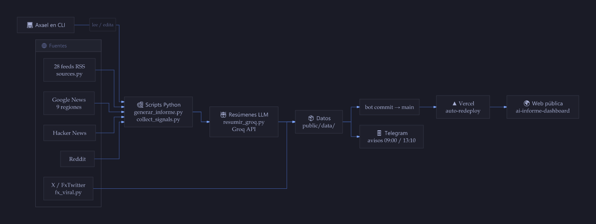
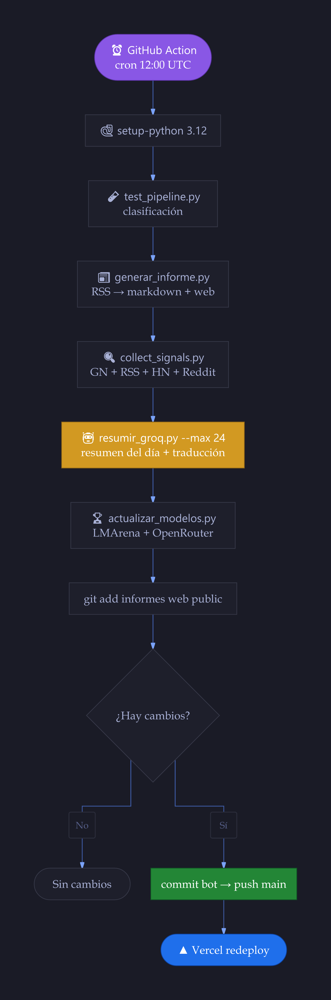
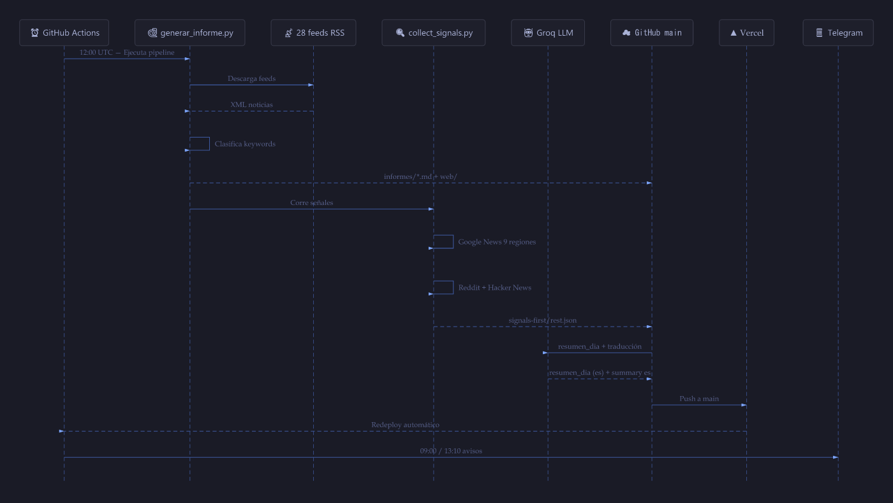
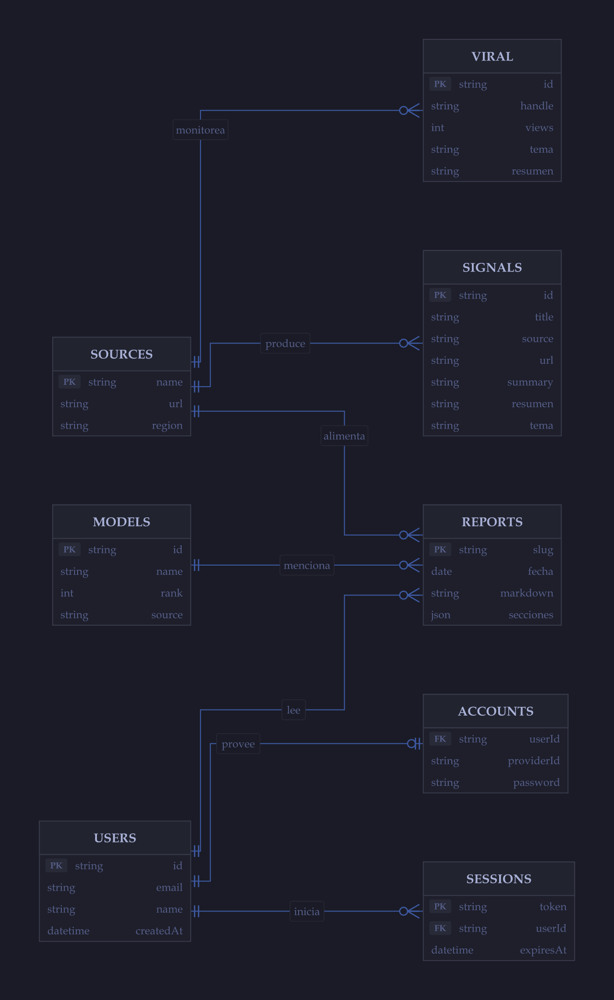
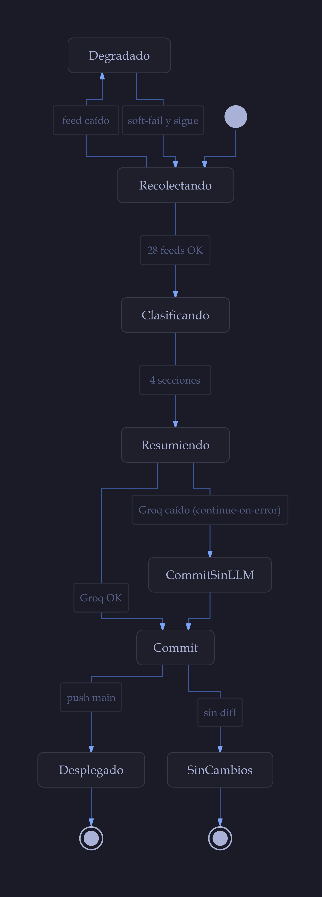

# AI Informe

Recopilación **diaria y automática** de noticias de IA (novedades, usos reales, economía, señales de futuro y seguridad). Python + GitHub Actions, publicado en Vercel.

[](https://github.com/traderxael/AI-Informe-/actions)
[](https://github.com/traderxael/AI-Informe-/commits/main)
[](LICENSE)
[](https://ai-informe.vercel.app)

## Ver el dashboard

| Entorno | URL |
|--------|-----|
| Producción | [ai-informe.vercel.app](https://ai-informe.vercel.app) |
| Repositorio | [github.com/traderxael/AI-Informe-](https://github.com/traderxael/AI-Informe-) |
| Tendencias del ranking (Elo LMArena, historial diario) | [ai-informe.vercel.app/tendencias](https://ai-informe.vercel.app/tendencias) |
| Estadísticas del proyecto (señales, Elo promedio, feeds, fuentes) | [ai-informe.vercel.app/estadisticas](https://ai-informe.vercel.app/estadisticas) |

## Qué hace de verdad

- RSS públicos (labs, medios, Google News multi-país, HN, Reddit con degradación suave). 33 feeds vivos, auditados con `scripts/auditar_feeds.py` (fallback TLS 1.2 ante 403).
- Informe markdown diario en `informes/YYYY-MM-DD.md`.
- JSON para la web: `public/data/signals-first.json`, `signals-rest.json`, `modelos.json`, **`modelos-history.json`** (Elo compacto por corrida).
- **Tendencias y estadísticas**: rutas `/tendencias` (Elo LMArena con historial diario) y `/estadisticas` (KPIs del proyecto: señales, Elo promedio, feeds y organizaciones). Portada con toggle ES/EN y botón de compartir (CSP-safe).
- Ranking de modelos: Elo LMArena (dataset oficial en Hugging Face) × precios OpenRouter. Si la fuente no responde, no sobrescribe el JSON anterior y el run queda rojo con evidencia.
- **Salud de fuentes**: `scripts/feed_health.py` → `public/data/feed_health.json` (items por feed + estado del ranking). La portada muestra el resumen y el archivo queda versionado.
- **Resúmenes LLM en español** con Groq (`scripts/resumir_groq.py`, Secret `GROQ_API_KEY`): resumen del día + traducción de señales. Opcional: si no hay key o Groq cae, el informe sigue publicándose.
- **Señales de X (Twitter)**: `scripts/fx_viral.py` monitorea 17 cuentas + 5 búsquedas de nicho vía FxTwitter API → `datos/fx_viral_YYYY-MM-DD.json` (top-40 por views, agrupado por tema). Es también la cola de contenido para clips de AutoClip.
- La portada **carga esas señales**, no una semana congelada.
- **Tendencias del ranking** (`#tendencias`): gráfica SVG de Elo por modelo, run a run — la historia crece con cada ejecución diaria (`actualizar_modelos.py` → `public/data/modelos-history.json`).
- **Estadísticas del proyecto** (`#estadisticas`): señales en 30 días, promedio/día, Elo promedio, feeds OK, modelos por organización y fuentes con más artículos (todo desde los JSON de la portada).
- **Español / English**: el toggle ES|EN en la portada traduce los textos principales (guarda tu elección en el navegador). Toggle y secciones en JS externo (`public/static-i18n.js`, `public/static-secciones.js`).
- **Compartir**: botón «Copiar enlace» en la portada + «Compartir» con Web Share API en la interfaz web.
- **Buscador full-text del archivo** (`#archivo`): busca en los 30 días de señales (título, resumen, fuente, país, sección) — resultados con fecha y enlace, sin recargar la página (`public/static-buscar.js`).
- **Feed RSS/Atom**: [`/feed.xml`](https://ai-informe.vercel.app/feed.xml) (RSS 2.0) y [`/feed.atom`](https://ai-informe.vercel.app/feed.atom) (Atom 1.0), regenerados a diario por `scripts/generar_feed.py`.
- **Notificación diaria** (opcional): bot de Telegram y/o webhook de Discord reciben el resumen del día (`scripts/notificar.py`). Sin secrets, el paso se omite sin romper nada.
- **Newsletter por email** (opcional): resumen diario vía Resend (`scripts/enviar_newsletter.py`). Sin secrets, el paso se omite.

## Notificaciones y newsletter (opcional)

Para activarlos hay que configurar secrets en el repo → *Settings → Secrets and variables → Actions*:

```bash
# Telegram (habla con @BotFather, crea un bot, copia el token)
gh secret set TELEGRAM_BOT_TOKEN --body "123456:AAH..."
gh secret set TELEGRAM_CHAT_ID   --body "-1001234567890"
# (chat id se obtiene enviándole un mensaje al bot y consultando
#  https://api.telegram.org/bot<TOKEN>/getUpdates)

# Discord (canal → Editar canal → Integraciones → Webhooks → Nuevo webhook)
gh secret set DISCORD_WEBHOOK_URL --body "https://discord.com/api/webhooks/..."

# Email vía Resend (resend.com → API keys; dominio verificado para enviar)
gh secret set RESEND_API_KEY  --body "re_..."
gh secret set NEWSLETTER_FROM --body "AI Informe <informe@tudominio.cl>"
gh secret set NEWSLETTER_TO   --body "amigo@a.cl,colega@b.cl"
```

Con eso el workflow diario (`informe-diario.yml`) notifica después de commitear cada informe. Si alguna clave falta o falla, el informe **se publica igual** — estos pasos son `continue-on-error`.

X / Instagram / TikTok / Xiaohongshu: para X ya hay monitor propio (`fx_viral.py`); el resto requiere levantar RSSHub local (`docker/rsshub`) y `social_sources.json`.

## Arquitectura

<details>
<summary>Ver diagramas (arquitectura, pipeline diario, modelo de datos, corrida y estados)</summary>

### Flujo general



### Pipeline diario (cron 12:00 UTC)



### Corrida completa paso a paso



### Modelo de datos



### Estados de una corrida



</details>

Vectoriales editables en [`docs/diagramas/svg/`](docs/diagramas/svg/) y código Mermaid en [`docs/diagramas/`](docs/diagramas/) (`*.mmd`) para regenerar o re-tematizar.

## Estructura

```
scripts/
  sources.py              # lista única de feeds (única fuente de verdad)
  generar_informe.py      # RSS → markdown + web/  (gzip-safe, reintentos con backoff)
  generar_feed.py         # RSS 2.0 + Atom → public/feed.xml y feed.atom (sin red)
  notificar.py            # resumen del día por Telegram/Discord (secrets opcionales)
  enviar_newsletter.py    # resumen por email vía Resend (secrets opcionales)
  collect_signals.py      # Google News + RSS + HN + Reddit → public/data/signals-*.json
  fx_viral.py             # X/Twitter vía FxTwitter → datos/fx_viral_*.json
  resumir_groq.py         # resúmenes LLM en español (Groq) + traducción de señales
  actualizar_modelos.py   # LMArena (dataset HF) + OpenRouter → public/data/modelos.json
  feed_health.py          # salud de los 33 feeds + ranking → public/data/feed_health.json
  auditar_feeds.py        # diagnóstico: cuántos items trae cada feed (herramienta)
  test_pipeline.py        # tests sin red (68 tests)
  with-app-env.brace-regression.test.mjs # regresión del wrapper en Windows
informes/                 # un markdown por día
datos/                    # JSON diario de señales de X (cola de clips AutoClip)
public/data/              # JSON que consume la web
web/                      # HTML generado de los markdown (versión estática legada)
docs/diagramas/           # diagramas Mermaid: *.mmd + svg/ + png/
.github/workflows/informe-diario.yml
```

## Uso local

```bash
python scripts/test_pipeline.py     # 68 tests, sin red
python scripts/generar_informe.py    # RSS → informes/*.md + web/
python scripts/collect_signals.py    # señales Google News + HN + Reddit
python scripts/fx_viral.py           # señales de X (o --local con FxEmbed propio)
python scripts/actualizar_modelos.py --max 60
python scripts/feed_health.py        # salud de los 33 feeds y del ranking
python scripts/auditar_feeds.py      # cobertura real de los 33 feeds (cuántos items trae cada uno)
```

Web (si usás el frontend TanStack):

```bash
npm install && npm run dev
```

## GitHub Actions

- `ci.yml`: ejecuta en cada PR y en `main` `npm ci`, lint, typecheck, tests frontend/Python y build.
- `informe-diario.yml`: cron `0 12 * * *` (09:00 Chile) o manual con `workflow_dispatch`. Pasos, todos con `continue-on-error` donde corresponde:

1. Tests de clasificación (`test_pipeline.py`)
2. Generar informe (markdown + web)
3. Recolectar signals (Google News + RSS + Reddit + HN, máx. 40 traducciones)
4. Resúmenes LLM (Groq) — requiere Secret `GROQ_API_KEY`
5. Ranking de modelos (LMArena vía dataset HF + OpenRouter)
6. **Señales de X (FxTwitter)** — 17 cuentas + 5 búsquedas de nicho
7. Salud de fuentes (`feed_health.py`) → `public/data/feed_health.json`
8. Commit a `main` (`informes`, `web`, `public`, `datos`) → Vercel redeploy
9. Verificación post-commit: falla el run si el ranking quedó vacío o la salud está incompleta

Si el push a `main` falla por required checks, el job `generar` no puede ser un status check obligatorio sobre sí mismo: desactivalo o permití bypass a `github-actions[bot]`.

## Licencia

MIT — ver [LICENSE](LICENSE).
