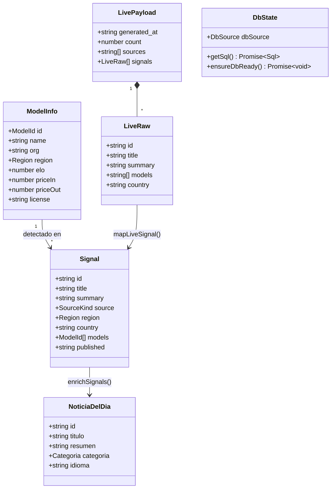
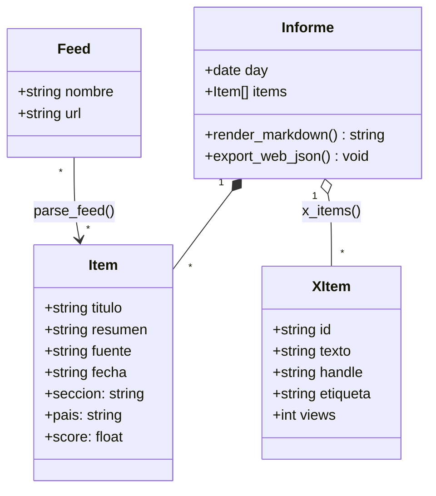

# Class Diagram

## Core Types (frontend, `src/lib/`)

## Pipeline Types (Python, implícitos en dicts)

## Notes

- El pipeline Python **no usa clases**: todo son `dict[str, Any]` con claves literales. Los diagramas son conceptuales, no tipos declarados.
- `ModelId` es un union type validado en runtime por `isModelId()`.
- `dbSource` es `"neon"` o `"pglite"` según haya `databaseUrl`; no es una clase, es una constante.
- `src/routeTree.gen.ts` es generado por TanStack Router; no editar a mano.
