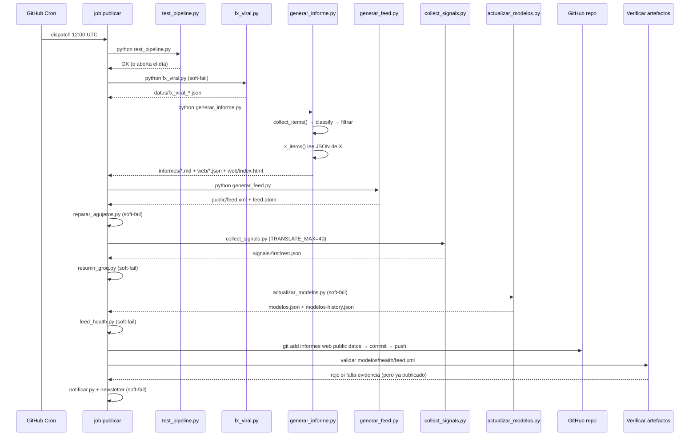
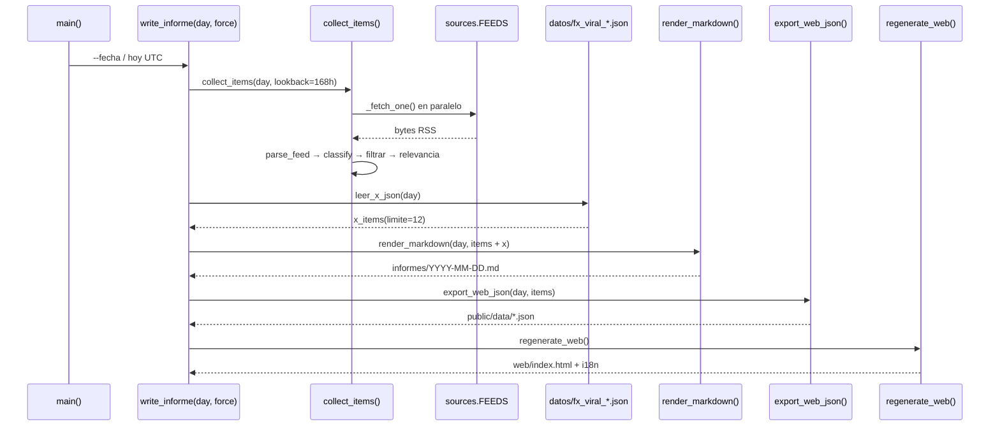
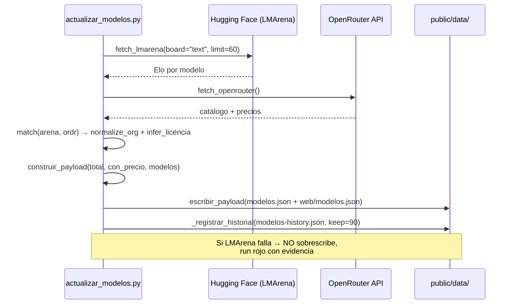

# Sequence Diagrams

## Workflow: Publicación diaria (informe-diario.yml)

El flujo que corre a las 12:00 UTC. `test_pipeline.py` es el único gate bloqueante antes de publicar; los demás pasos son soft-fail.

### Walkthrough

1. **Trigger** — `.github/workflows/informe-diario.yml`, `on.schedule.cron: "0 12 * * *"`.
2. **Gate bloqueante** — `python scripts/test_pipeline.py`.
3. **X antes que el informe** — comentario explícito en el workflow.
4. **Commit** — `git add informes web public datos`; si no hay diff, "Sin cambios".
5. **Gate final** — Python inline valida tres artefactos **después** del push.

## Workflow: Generación del informe (`generar_informe.write_informe`)

### Walkthrough

1. `main()` — [`scripts/generar_informe.py:1350`](https://github.com/traderxael/AI-Informe-/blob/c51dcc5/scripts/generar_informe.py#L1350).
2. `write_informe()` — [`:1322`](https://github.com/traderxael/AI-Informe-/blob/c51dcc5/scripts/generar_informe.py#L1322) — siempre regenera (`force=True` implícito).
3. `collect_items()` — [`:713`](https://github.com/traderxael/AI-Informe-/blob/c51dcc5/scripts/generar_informe.py#L713).
4. `x_items()` — [`:817`](https://github.com/traderxael/AI-Informe-/blob/c51dcc5/scripts/generar_informe.py#L817).
5. `render_markdown()` — [`:885`](https://github.com/traderxael/AI-Informe-/blob/c51dcc5/scripts/generar_informe.py#L885).

## Workflow: Ranking de modelos (LMArena × OpenRouter)

### Walkthrough

1. `fetch_lmarena()` — [`:121`](https://github.com/traderxael/AI-Informe-/blob/c51dcc5/scripts/actualizar_modelos.py#L121).
2. `fetch_openrouter()` — [`:140`](https://github.com/traderxael/AI-Informe-/blob/c51dcc5/scripts/actualizar_modelos.py#L140).
3. `match()` — [`:188`](https://github.com/traderxael/AI-Informe-/blob/c51dcc5/scripts/actualizar_modelos.py#L188).
4. El frontend consume `MODELS` en [`src/lib/informe-data.ts:48`](https://github.com/traderxael/AI-Informe-/blob/c51dcc5/src/lib/informe-data.ts#L48).
